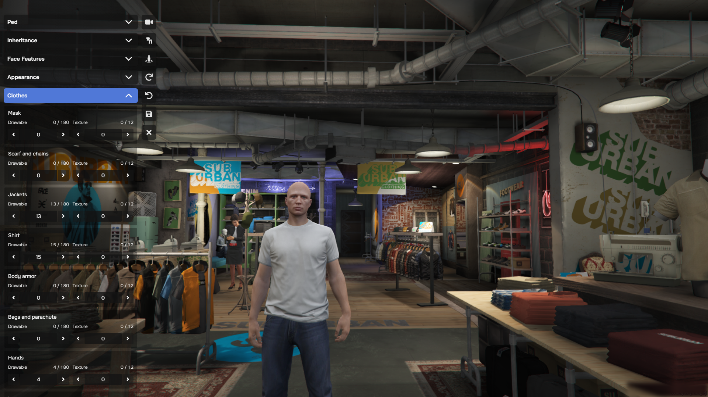

# illenium-appearance

Character appearance for Project Cobalt: clothing stores, barbers, tattoo parlors, plastic surgeons and saved outfits.

This is a fork of [illenium-appearance](https://github.com/iLLeniumStudios/illenium-appearance), maintained and updated by Project Cobalt alone. Report issues here, not upstream.

Discord: https://discord.gg/wFneTufDq9

## Dependencies

- [cobalt_core](https://github.com/Project-Cobalt-FiveM/cobalt_core)
- [cobalt_mysql](https://github.com/Project-Cobalt-FiveM/cobalt_mysql)
- [cobalt_interfaces](https://github.com/Project-Cobalt-FiveM/cobalt_interfaces)
- [ox_lib](https://github.com/Project-Cobalt-FiveM/ox_lib)
- [ox_target](https://github.com/Project-Cobalt-FiveM/ox_target) (optional)

## Features

- Clothing stores, barbers, tattoo parlors and plastic surgeons
- Saved player outfits, with shareable outfit codes
- Job and gang clothing rooms, limited by rank
- Job and gang locked stores
- Outfit locations limited to specific characters
- Hair textures and a secondary makeup color
- Components, props and peds limited to jobs, gangs, characters or ACEs, for VIP clothing
- Job and gang clothes kept across reconnects and logouts
- Components and props that can be turned off entirely, for clothing as items
- `/pedmenu` (configurable) and `/reloadskin` commands

## Credits

Forked from illenium-appearance by iLLeniumStudios and snakewiz, itself based on [fivem-appearance](https://github.com/pedr0fontoura/fivem-appearance) by pedr0fontoura.
